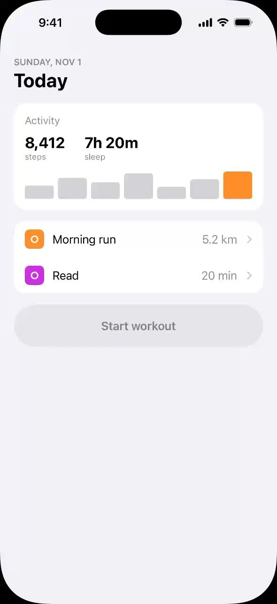

<p align="center"></p>

<h1 align="center">AnnotateKit</h1>

<p align="center">
<b>Visual feedback for iOS apps, straight to your coding agent.</b><br>
AnnotateKit turns drawings and comments inside your iOS apps into prompts for your agent.<br>
Tap, draw, and send to Claude, Codex, Cursor, or any AI agent.
</p>

<p align="center">
<a href="https://github.com/ooolzhas/annotatekit/actions/workflows/ci.yml"></a>
<a href="https://swiftpackageindex.com/ooolzhas/annotatekit"></a>
<a href="https://swiftpackageindex.com/ooolzhas/annotatekit"></a>
<a href="LICENSE"></a>
</p>

<p align="center"><a href="https://annotatekit.com"><b>annotatekit.com</b></a></p>

<p align="center"><a href="https://annotatekit.com"></a></p>

## How to use

1. Tap **Annotate** to enable
2. **Draw, tap** or **hold** to annotate
3. Add a note, attach an image
4. Tap **↑** to send to your agent
5. Track status via the inline indicator

Works on device and in the simulator. Everything is hidden behind an `#if DEBUG` flag.

## What agents get

Agents find things by looking, so every note arrives as a specific component to check, not a
description to interpret.

- **Lightweight screenshots** to reduce back-and-forth
- **Drawings** to easily communicate ideas
- **Coordinates & component trees** to edit with surgical precision
- **Device metadata** to understand layouts
- **Your notes** to bind it all together

**Before:** you write "blue button near the bottom is too small" and the agent guesses.

**After:** the agent reads `Button "Get started" at (24, 300, 120×44)` and can edit the component
directly, with zero ambiguity and no extra prompts.

## Install

### Let your agent do it

Tell Claude, Cursor or Codex:

> Set up AnnotateKit from github.com/ooolzhas/annotatekit in this app.

The repo's [`annotate-setup` skill](skills/annotate-setup/SKILL.md) guides the agent through any
project shape (Xcode project, XcodeGen, Tuist, SwiftPM), the CLI and the connection. In Claude, one
plugin brings the skill, MCP server and CLI:

```
/plugin install annotate --marketplace ooolzhas/annotatekit
```

Before Claude Code 2.1.275: `/plugin marketplace add ooolzhas/annotatekit`, then
`/plugin install annotate@annotatekit`.

### By hand

**1. The overlay.** Add the package with Swift Package Manager and link **AnnotateKit** to your app
target (iOS 17+).

```
https://github.com/ooolzhas/annotatekit
```

```swift
import AnnotateKit

@main
struct MyApp: App {
    init() {
        Annotate.install()   // DEBUG-only; a no-op in Release
    }
    var body: some Scene { WindowGroup { ContentView() } }
}
```

Then add `.annotate/` to your `.gitignore`.

**2. The CLI.** Not needed with the Claude plugin. Pick one:

```sh
brew install ooolzhas/tap/annotate
npm install -g annotate-ios
mint install ooolzhas/annotatekit
```

## Connect your agent

Pick how a send reaches your agent:

| Agent | How sends reach it |
|---|---|
| **Claude + channels** (recommended) | Pushed into your open session the moment you send, even while Claude is idle. Start with `claude --dangerously-load-development-channels plugin:annotate@annotatekit`, or `server:annotate` without the plugin. |
| **Claude, no flags** | Run `/annotate-watch`. A watcher picks up each send. |
| **Unattended** | `annotate run` in the project root runs `claude -p` per send (`--permission-mode acceptEdits`, resuming the conversation). |
| **Cursor, Codex, VS Code, Claude desktop, any MCP client** | Add the server (below) and ask the agent to *"keep calling annotation_wait"*: each call blocks until you send, then returns the notes. Or say *"check my latest annotation"* now and then. |

[Channels](https://code.claude.com/docs/en/channels) are a Claude Code research preview. During the
preview, a channel server that isn't on Anthropic's allowlist has to be named with
`--dangerously-load-development-channels`. The flag lifts only that allowlist check for the server
you name, and Claude Code asks you to confirm. Team and Enterprise orgs need an admin to enable
channels.

<details>
<summary>MCP config for Cursor, VS Code and Codex</summary>

The server is `annotate mcp` over stdio, run from the project root.

```jsonc
// Claude Code without the plugin: claude mcp add annotate --scope project -- annotate mcp
// Cursor — .cursor/mcp.json
{ "mcpServers": { "annotate": { "command": "annotate", "args": ["mcp"] } } }

// Nothing installed? npx fetches the CLI on first run (macOS)
{ "mcpServers": { "annotate": { "command": "npx", "args": ["-y", "annotate-ios", "mcp"] } } }

// VS Code — .vscode/mcp.json
{ "servers": { "annotate": { "type": "stdio", "command": "annotate", "args": ["mcp"] } } }
```

```toml
# Codex — ~/.codex/config.toml
[mcp_servers.annotate]
command = "annotate"
args = ["mcp"]
```

Tools:
- `annotation_wait` blocks until you send (or answer a question), batches for a few seconds and
  returns everything. It gives hands-free delivery in any MCP client, and the pill's dot goes green
  while an agent waits.
- `get_annotation_session` returns the prompt plus annotated screens and crops as images.
- `annotation_status` reports progress back to the device.
- `annotation_acknowledge` says which pin the agent is starting on; the device shows "Working on
  note 2" and spins only that pin's badge.
- `annotation_resolve` / `annotation_dismiss` report per pin.
- `annotation_ask` asks the user about one pin and waits for the answer. Asking again on the same
  pin continues the conversation: the reply card and the notes sheet show the earlier exchange.
- `list_annotation_sessions` lists recent sessions.
</details>

## Gestures

| Action | Gesture / key |
|---|---|
| Enter annotate mode (freezes the screen) | The **Annotate** pill, `Annotate.start()`, or launch with `ANNOTATE=1` (waits for the first settled screen; `ANNOTATE_DELAY=<seconds>` for a fixed wait) |
| Draw | Drag anywhere. Further strokes join the open note while its card is up; the note is attributed to the view under the drawing |
| Select an element | Tap. The whole element under your finger is outlined |
| Pin an exact spot | Hold still for half a second |
| Walk element → containers | `↑` / `↓` before saving |
| Comment and save | Type, then ↑ (`Return` types a newline). The chip picks **Fix** or **Question**; the paperclip attaches up to 4 images |
| Undo / redo a stroke | The card's undo and redo buttons, or `⌘Z` / `⇧⌘Z`. `⌘Z` with no note open removes the last one |
| Discard the open note | × in undo's place, once there's nothing left to undo |
| Back out | `Esc` |
| Send | **↑** on the bar or `⌘Return`. Annotate mode stays open with the sent notes' progress |
| See, open or delete notes | Tap the note count on the bar: the notes sheet lists them; swipe to delete, the trash icon clears them all |

To annotate another screen, leave annotate mode, navigate, and come back. One send carries every
screen with pins on it.

In the Simulator, `Return`, `Esc` and the arrow keys reach the app as long as the hardware keyboard
is connected. ⌘-shortcuts go to the Simulator app unless *I/O → Keyboard → Send Keyboard
Shortcuts to Device* is on. The on-screen buttons always work.

## Tracking status

After you send, annotate mode stays open and the pill narrates the agent's progress: *Claude received
your notes → Claude is working… → All changes applied · Reinstalling*. Each note's badge spins until
the agent handles it, then turns into a green check. The pill's dot is green while an agent listens,
yellow while it reconnects, and red when nothing does.

- **Intent per pin.** On the comment card, pick **Fix** (the default) or **Question** (explain it,
  don't edit). Pins carry their intent into the prompt.
- **Per-pin results.** The agent reports each pin as resolved (with what changed) or dismissed (with
  why). Tap the note count on the bar: the notes sheet sorts every note into Current, In Progress,
  Resolved and Failed.
- **Questions.** When a pin is unclear, the agent asks about it. The pill and hint line say so, and the
  notes sheet has a **Reply** button. Your answer goes back to the agent, from a phone too.
- **Prompt size.** `AnnotateOptions(promptDetail: .compact)` saves tokens. `.detailed` adds every
  screen's visible text.

The plugin's Stop hook (`annotate hook stop`) keeps Claude from ending its turn while a send it
worked on still shows as in progress on the device, so the app never waits on a forgotten "done".

Agents report with the MCP tools above, or with the CLI:

```sh
annotate ack <id> <pin>                 # starting on this pin
annotate resolve <id> <pin> "what changed"
annotate dismiss <id> <pin> "why not"
annotate ask <id> <pin> "question"      # waits for the answer and prints it
```

Every file involved is documented in [SCHEMA.md](SCHEMA.md).

## Coordinates are the contract

- All frames and points are **iOS points, origin top-left**, relative to the frozen screen.
- `screens/N.png` is **1x: one pixel per point**. A pin at `(84, 322)` is pixel `(84, 322)`. A
  402×874 pt screen is a 402×874 image, which vision models see unscaled.
- `screens/N-annotated.png` adds numbered blue markers, outlines and red drawings.
  `crops/N.png` (native resolution, 32 pt of context) carries the detail. A full native-resolution
  screen is opt-in.
- Each pin has an **anchor** (exactly where you tapped, or a drawing's center), a **frame**, and
  percentages across and down.
- Each pin lists its **nearby text**, and each screen lists every visible label with its frame.
  That's usually enough for an agent to grep its way to the right SwiftUI view, with no tagging.

<details>
<summary>The prompt your agent receives</summary>

```
UI annotations from the running app: 3 pins on 1 screen. Please make these changes in the code.

Session: /Users/me/app/.annotate/sessions/20261028-141502-a1b2
Device: iPhone 17 Pro · iOS 26.0 · 402×874 pt @3x · dark · Dynamic Type L
Coordinates are iOS points, origin top-left. Screen images are 1x, so pixel = point. Open the
annotated image first: each pin is a numbered blue marker there. Crops show detail.

Screen 1 (402×874 pt) — annotated …/screens/1-annotated.png · clean …/screens/1.png

1. Button "Get started" at (24, 300, 120×44) — tapped (84, 322), 21% across, 37% down
   bigger, tighter
   Nearby text: "Light that follows your day"
   Crop: …/crops/1.png

2. Spot at (179, 678, 44×44) — tapped (201, 700), 50% across, 80% down
   too much empty space here
   Nearby text: "Halo Pendant", "2700K warm white"
   Crop: …/crops/2.png

3. Sketch over Image "Halo Pendant" at (190, 520, 180×140) — center (280, 590), 70% across, 68% down
   make this card a carousel
   Drawn on the screen in red (pen); see the crop
   Crop: …/crops/3.png

Full detail (all frames, visible text per screen, sketch vectors): …/session.json

When you're done, finish with a one-line summary of what you changed.
```
</details>

## The session bundle

```
<project root>/.annotate/           gitignored automatically
  latest                            "sessions/<id>"
  sessions/<id>/
    prompt.md                       the message above
    screens/1.png  1-annotated.png  (1@3x.png with includesHiResScreens)
    crops/1.png …
    session.json                    written last, so it marks the bundle complete (schema v1)
    status.json                     written by the receiver: delivered → received → working → done | failed, plus per-pin results
    replies.json                    your answers to the agent's questions
  agent.json                        who is listening (the pill's dot), merged from agents/<pid>.json
```

Simulator apps can write to the Mac's file system. AnnotateKit finds your project root by walking up
from the `#filePath` of `Annotate.install()` to the nearest `.git`, and it polls `status.json` to
show progress on the pill.

**On a physical iPhone or iPad** it works the same, with nothing to set up in the app:
- **Where the bundle goes:** the app writes it to its own Documents folder.
- **How it reaches the Mac:** whichever `annotate` process is running (`mcp`, `watch` or `run`)
  copies it into the project's `.annotate/` over the developer connection Xcode uses (`devicectl`,
  USB or Wi-Fi). That needs no network permission and no Info.plist keys, just a development build
  on a paired device.
- **Which checkout gets it:** each bundle records the `Annotate.install()` file it was built from,
  so a send reaches the checkout the build came from. With two worktrees, each one's agent gets its
  own builds' sends.
- **Back to the phone:** status and the connection dot are copied back, so the pill narrates there
  too.

The schema is defined in [`Session.swift`](Sources/AnnotateCore/Session.swift). `AnnotateCore` is
Foundation-only, so viewers, bots and other tools can depend on it without UIKit.

## Lightweight by design

- **Zero cost in Release.** Every overlay type is behind `#if DEBUG`. `Annotate.install()` and
  `.annotatable()` compile to empty stubs, and the package has no dependencies.
- **Near-zero cost in DEBUG until you annotate.** The accessibility tree is switched on the first
  time you enter annotate mode, not at launch. `.annotatable()` views do no geometry work while
  annotate mode is off. The idle launcher re-reads the app's bottom chrome once a second with a
  plain UIKit view walk (no accessibility tree, no capture) to keep off its bars. With the launcher
  hidden, no overlay window exists until `Annotate.start()`.
- **Instant enter, instant send.** Entering annotate mode takes a single screen capture. The
  visible-text outline is scanned only when the first pin needs it. Send returns immediately,
  while rendering, PNG encoding and writing happen off the main thread, in 8-bit sRGB rather than
  the 16-bit wide-color default.
- **Small bundles.** A 1x screen (pixel = point), an annotated copy, and one native-resolution crop
  per pin. Full high-res screens are opt-in (`includesHiResScreens`), and only the last 30 sessions
  are kept (`keepsSessions`).
- **Cheap watching.** The CLI skips sessions older than its start time without touching the disk.

## How selection works

On tap, AnnotateKit asks UIKit which view would receive the touch. It then walks that view's
ancestors, its subtree, and the accessibility children of both, so views behind a sheet are skipped.
SwiftUI `Text`, `Button` and `Image` exist at runtime only as accessibility nodes, so it turns on
the in-process accessibility tree the first time you annotate, the same switch XCUITest flips. You
can opt out with `AnnotateOptions(enablesAccessibilityTree: false)`. Candidates are sorted
smallest-first. If only a big container (more than 40% of the screen) is under your finger, the pin
starts as a spot at the exact point.

**Optional: exact source lines.** Add `.annotatable()` to a view and pins on or inside it carry its
`file:line`. It's never required.

**Optional: keep the launcher off your bar.** The idle pill moves off UIKit tab bars, toolbars, text
inputs and controls by itself, lifting above them or moving to a side. A bar SwiftUI draws itself
isn't a UIKit view, so tag it with `.annotateAvoid()`.

## Repository layout

```
Sources/AnnotateCore    schema, selection, screen outline, prompt, bundle + status I/O (Foundation only)
Sources/AnnotateKit     the DEBUG-only overlay and the public `Annotate` API
Sources/AnnotateAgent   Mac side: session discovery/claims, MCP channel server, headless runner
Sources/AnnotateCLI     the `annotate` executable
skills/                 annotate-setup and annotate-watch (Agent Skills format)
.claude-plugin/         Claude Code plugin + marketplace; bin/annotate is the plugin's launcher
packaging/              Homebrew formula template and the npm package (`annotate-ios`)
site/                   annotatekit.com (static, no build step), deployed by Vercel
```

`swift test` runs the AnnotateCore and AnnotateAgent suites on macOS and Linux. See
[CONTRIBUTING.md](CONTRIBUTING.md) and [AGENTS.md](AGENTS.md).

## Limitations

- Frames assume a full-screen window (iPhone, or a full-screen iPad app). Stage Manager windows
  aren't handled.
- There's no hover highlight: the iPhone Simulator doesn't deliver pointer hover to apps.
- Channels are a Claude Code research preview, so their flags and protocol may change.

## Roadmap

- Device / Dynamic Type / appearance switcher that re-captures the same screen
- Live style panel: nudge spacing, radius and color in place, then send the diff
- Listing in the official MCP Registry

## License

AnnotateKit is open source under the [MIT license](LICENSE).

- [Star AnnotateKit on GitHub ↗](https://github.com/ooolzhas/annotatekit)
- [Follow @ooolzhas on X ↗](https://x.com/intent/follow?screen_name=ooolzhas)

Contributions welcome: see [CONTRIBUTING.md](CONTRIBUTING.md) and the
[Code of Conduct](CODE_OF_CONDUCT.md).
