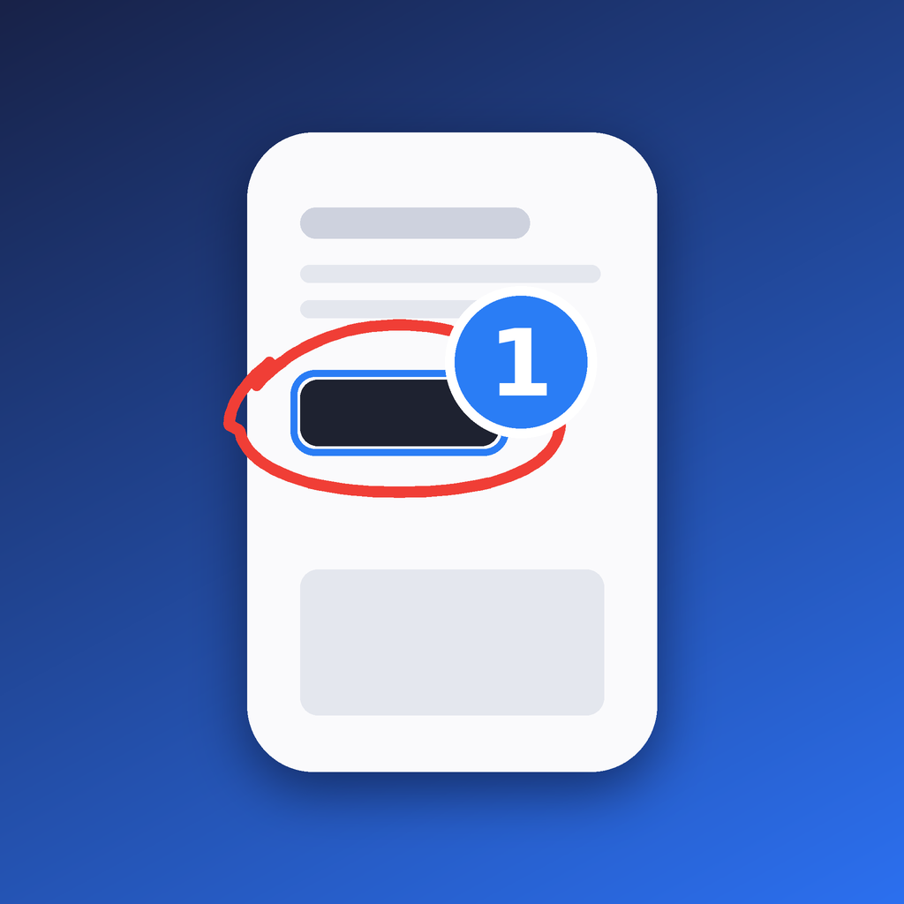

# AnnotateKit

[](https://github.com/ooolzhas/annotatekit/actions/workflows/ci.yml)
[](Package.swift)
[](Package.swift)
[](https://www.npmjs.com/package/annotate-ios)
[](LICENSE)

**[AnnotateKit](https://annotatekit.com)** turns drawings and comments inside your iOS app into
prompts for your coding agent. Tap, draw, and send to Claude, Codex, Cursor, or any MCP client.

Works on device and in the simulator. Everything is behind `#if DEBUG`, so Release builds carry
none of it.

## Install

Tell your agent:

> Set up AnnotateKit from github.com/ooolzhas/annotatekit in this app.

The [`annotate-setup` skill](skills/annotate-setup/SKILL.md) handles Xcode projects, XcodeGen,
Tuist and SwiftPM. In Claude Code, one plugin brings the skill, the MCP server and the CLI:

```
/plugin install annotate --marketplace ooolzhas/annotatekit
```

<details>
<summary>By hand</summary>

Add `https://github.com/ooolzhas/annotatekit` with Swift Package Manager and link **AnnotateKit**
to your app target.

```swift
import AnnotateKit

@main
struct MyApp: App {
    init() { Annotate.install() }   // no-op in Release
    var body: some Scene { WindowGroup { ContentView() } }
}
```

Add `.annotate/` to your `.gitignore`, then install the CLI (not needed with the Claude plugin):

```sh
brew install ooolzhas/tap/annotate   # or: npm install -g annotate-ios · mint install ooolzhas/annotatekit
```
</details>

## Usage

1. Tap **Annotate** to freeze the screen
2. **Draw**, **tap** an element, or **hold** on a spot
3. Add a note, attach an image
4. Tap **↑** to send
5. Follow the agent's progress on the pill

## Connect your agent

| Agent | Setup |
|---|---|
| **Claude Code** (recommended) | `claude --dangerously-load-development-channels plugin:annotate@annotatekit`. Sends arrive in your open session, even while it's idle. |
| **Claude Code, no flags** | Run `/annotate-watch`. |
| **Cursor, Codex, VS Code, any MCP client** | Add `annotate mcp` (below) and ask the agent to *"keep calling annotation_wait"*. |
| **Unattended** | `annotate run` in the project root runs `claude -p` per send. |

[Channels](https://code.claude.com/docs/en/channels) are a Claude Code research preview, which is
why the flag is needed.

<details>
<summary>MCP config</summary>

```jsonc
// Cursor: .cursor/mcp.json
{ "mcpServers": { "annotate": { "command": "annotate", "args": ["mcp"] } } }

// No CLI installed? npx fetches it on first run
{ "mcpServers": { "annotate": { "command": "npx", "args": ["-y", "annotate-ios", "mcp"] } } }

// VS Code: .vscode/mcp.json
{ "servers": { "annotate": { "type": "stdio", "command": "annotate", "args": ["mcp"] } } }
```

```toml
# Codex: ~/.codex/config.toml
[mcp_servers.annotate]
command = "annotate"
args = ["mcp"]
```

Claude Code without the plugin: `claude mcp add annotate --scope project -- annotate mcp`.
</details>

## What agents get

Each note arrives as a specific component to check, not a description to interpret.

- **Screenshots** at 1x (pixel = point), an annotated copy, and a crop per pin
- **Drawings** as images and vectors
- **Coordinates and the element under each pin**, with nearby text to grep for
- **Device metadata**: model, iOS version, size, appearance, Dynamic Type
- **Your notes**, each tagged **Fix** or **Question**

Instead of "the blue button near the bottom is too small", the agent reads
`Button "Get started" at (24, 300, 120×44)` and edits that view directly.

<details>
<summary>Example prompt</summary>

```
UI annotations from the running app: 2 pins on 1 screen. Please make these changes in the code.

Device: iPhone 17 Pro · iOS 26.0 · 402×874 pt @3x · dark · Dynamic Type L
Coordinates are iOS points, origin top-left. Screen images are 1x, so pixel = point.

Screen 1 (402×874 pt) — annotated …/screens/1-annotated.png · clean …/screens/1.png

1. Button "Get started" at (24, 300, 120×44) — tapped (84, 322), 21% across, 37% down
   bigger, tighter
   Nearby text: "Light that follows your day"
   Crop: …/crops/1.png

2. Sketch over Image "Halo Pendant" at (190, 520, 180×140) — center (280, 590), 70% across, 68% down
   make this card a carousel
   Crop: …/crops/2.png

Full detail (all frames, visible text per screen, sketch vectors): …/session.json
```
</details>

## Tracking status

The pill narrates delivery (*received → working → all changes applied*), and each pin's badge turns
into a check when the agent resolves it. Agents report per pin with MCP tools or the CLI:

| MCP tool | CLI | Does |
|---|---|---|
| `annotation_wait` | | Blocks until you send, then returns the notes |
| `get_annotation_session` | | Prompt plus screens and crops as images |
| `annotation_acknowledge` | `annotate ack <id> <pin>` | Shows "Working on note N" |
| `annotation_resolve` | `annotate resolve <id> <pin> "what changed"` | Marks a pin done |
| `annotation_dismiss` | `annotate dismiss <id> <pin> "why not"` | Declines a pin |
| `annotation_ask` | `annotate ask <id> <pin> "question"` | Asks you; you reply from the notes sheet |

The plugin's Stop hook keeps Claude from ending its turn while a send still shows as in progress.

## Gestures

| Action | Gesture |
|---|---|
| Enter annotate mode | **Annotate** pill, `Annotate.start()`, or launch with `ANNOTATE=1` |
| Draw | Drag anywhere |
| Select an element | Tap |
| Pin an exact spot | Hold for half a second |
| Save a note | Type, then **↑** on the card |
| Undo / redo a stroke | The card's undo and redo buttons; **×** discards the note |
| Review notes | Tap the note count on the bar |
| Send | **↑** on the bar |
| Leave annotate mode | **‹** on the bar (your notes are kept) |

To annotate another screen, leave annotate mode, navigate, and come back. One send carries every
screen.

## How it works

- **Selection.** A tap hit-tests UIKit, then walks the accessibility tree (switched on the first
  time you annotate) to find SwiftUI `Text`, `Button` and `Image`. No view tagging needed;
  `.annotatable()` optionally adds the view's `file:line`.
- **Delivery.** The app writes a session bundle to `.annotate/` in your project. On a physical
  device, the running `annotate` process copies it over `devicectl`, with no network permission or
  Info.plist keys. The bundle format is in [SCHEMA.md](SCHEMA.md).
- **Cost.** Nothing in Release and no dependencies. In DEBUG, near-zero until you enter annotate
  mode.

## Limitations

- iOS 17+ only. Frames assume a full-screen window; Stage Manager windows aren't handled.
- No hover highlight: the Simulator doesn't deliver pointer hover to apps.
- Channels are a research preview, so their flags may change.

## Contributing

See [CONTRIBUTING.md](CONTRIBUTING.md) and [AGENTS.md](AGENTS.md).

## License

[MIT](LICENSE) · [annotatekit.com](https://annotatekit.com) · [@ooolzhas](https://x.com/ooolzhas)
